# AI Zero Token 中文使用指南

> 面向第一次使用 AI Zero Token 的用户，内容以当前桌面客户端、CLI、管理界面和接口实现为准。

AI Zero Token 是一个本地优先的 OpenAI 兼容网关。它可以把 ChatGPT/Codex OAuth 账号池统一提供给 Codex、OpenClaw 和其他 OpenAI 兼容客户端，也可以把 OneAPI、OpenRouter 或自建兼容服务接入本机 Codex。它还包含接口测试、图床、统计、日志和网络诊断等辅助工具。

> AI Zero Token 不是 OpenAI 官方产品，适合本地单用户使用，不建议作为生产级多租户网关。

## 快速导航

| 功能 | 适合解决什么问题 | 入口 |
| --- | --- | --- |
| [对外提供 API](#1-对外提供-api) | 把 OAuth 账号池变成统一的 OpenAI 兼容 API | `模型与服务 → 对外提供 API` |
| [接入外部 API](#2-接入外部-api) | 把第三方或自建兼容服务接入 Codex | `模型与服务 → 接入外部 API` |
| [图床上传](#3-图床上传) | 把本地图片上传到 GitHub 并获取公网链接 | `图床上传` |
| [接口测试](#4-接口测试) | 在客户端内验证模型、对话、Responses 和图片接口 | `接口测试` |
| [用量统计](#5-用量统计) | 查看请求量、token、费用、图片和失败情况 | `用量统计` |
| [请求日志](#6-请求日志) | 按接口、模型、账号和状态排查请求 | `请求日志` |
| [网络检测](#7-网络检测) | 检查出口、DNS、代理、WebRTC 和平台连通性 | `网络检测` |
| [使用文档](#8-客户端内置使用文档) | 复制当前网关参数和示例代码 | `使用文档` |
| [系统设置](#9-系统设置) | 管理代理、诊断记录和邮箱脱敏 | `系统设置` |
| [Response Reviewer](#10-response-reviewer) | 审阅具体回复、添加批注并整理修改意见 | `工具` |
| [重置日历](#11-重置日历) | 按北京时间查看 Codex 公开重置消息与通知 | `重置日历` |
| [桌面更新](#桌面更新) | 查看发布说明、下载并重启安装 | 左侧更新入口 |

## 安装并打开桌面客户端

普通用户从 [GitHub Releases](https://github.com/fchangjun/AI-Zero-Token/releases) 下载桌面端：

| 系统 | 下载文件 |
| --- | --- |
| Apple Silicon Mac（M1/M2/M3/M4） | `AI Zero Token-{version}-mac-arm64.dmg` |
| Intel Mac | `AI Zero Token-{version}-mac-x64.dmg` |
| Windows 安装版 | `AI Zero Token Setup {version}.exe` |
| Windows 便携版 | `AI Zero Token-{version}-win.zip` |

macOS 当前发布包使用 ad-hoc 签名，尚未使用 Apple Developer ID 公证。如果系统把浏览器下载的 DMG 提示为“已损坏”或阻止打开，请先阅读 DMG 内的 `mac-install-guide.txt`，不要从非官方来源下载程序。

打开客户端后，先看左侧“服务与版本”区域：显示“服务运行中”就表示本地网关已经启动。实际端口以客户端里的 Base URL 为准，不一定与截图一致。

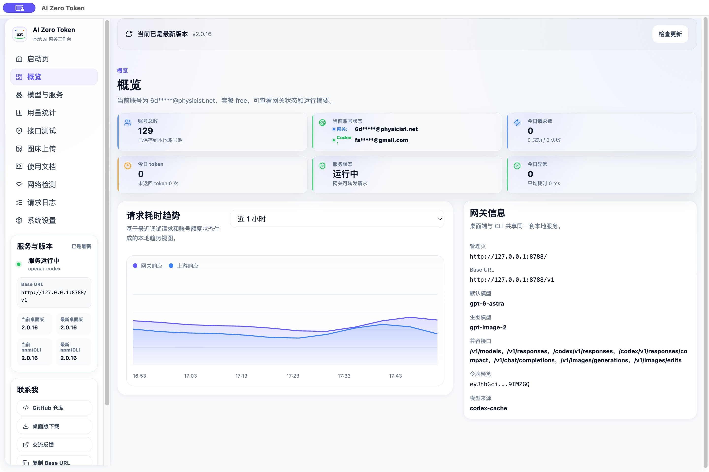

**成功标志：** 左侧显示“服务运行中”，并能看到形如 `http://127.0.0.1:端口/v1` 的 Base URL。

### 桌面更新

macOS 桌面版会检查 GitHub 正式发布。发现新版后，可从左侧更新入口、页面提示或系统通知打开详情，查看版本、发布时间、下载大小和升级记录。

跨版本升级时，更新详情按“当前版本之后、目标版本以内”汇总各个正式版本的功能简介，最新版本排在前面。例如从 2.0.16 升到 2.0.20，会同时列出 2.0.17、2.0.18、2.0.19、2.0.20，并提供各版完整说明入口。部分历史记录加载失败时可点击“检查更新”重试，已经校验的更新仍可正常下载。

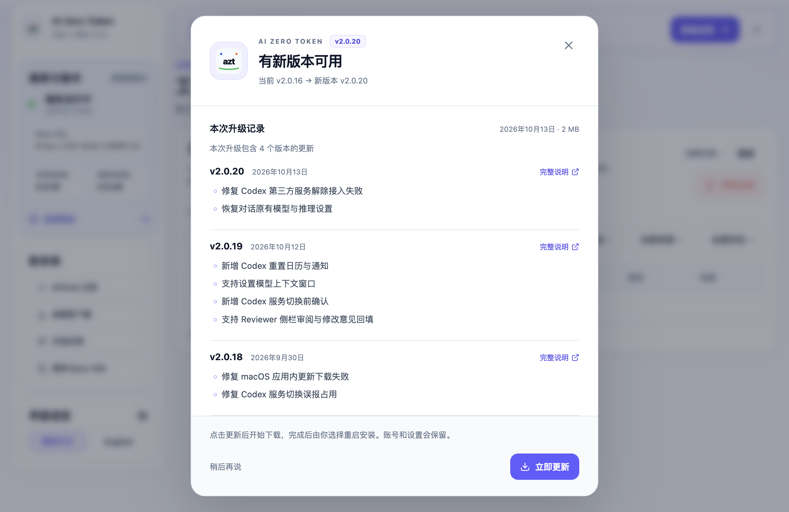

点击“立即更新”开始下载；下载与准备期间可以继续使用，也可以取消下载。准备完成后由你确认重启安装，不会直接打断当前工作。点击“稍后再说”会暂缓当前版本的提示，仍可从侧栏再次打开。返回应用时，距离上次检查超过五分钟会重新检查；网络失败时可手动重试。

更新会验证官方安装包的校验值、版本和架构。无法自动更新时按页面提示前往 GitHub 手动下载安装；Windows 当前使用手动下载安装方式。npm/CLI 独立使用 `npm install -g ai-zero-token` 更新。

2.0.18 修复了旧版下载 GitHub 安装包时的跳转失败。如果你正在使用 2.0.16 或 2.0.17 且下载失败，请手动安装 2.0.18 或更新版本一次；账号和设置目录不会改变。原生桌面窗口只显示桌面更新提示，不再同时提示 npm/CLI 更新。

## 1. 对外提供 API

### 功能用途与适用场景

“对外提供 API”会把已添加的 ChatGPT/Codex OAuth 账号组成账号池，对本机或局域网提供统一接口。适合：

- 让 Codex、OpenClaw、脚本或其他 OpenAI 兼容客户端使用同一个本地地址；
- 多个账号之间按可用状态自动轮换；
- 集中查看账号额度、可用模型、调用统计和请求日志。

### 1.1 添加账号

进入 `模型与服务 → 对外提供 API → 账号池`，点击“新增账号”。

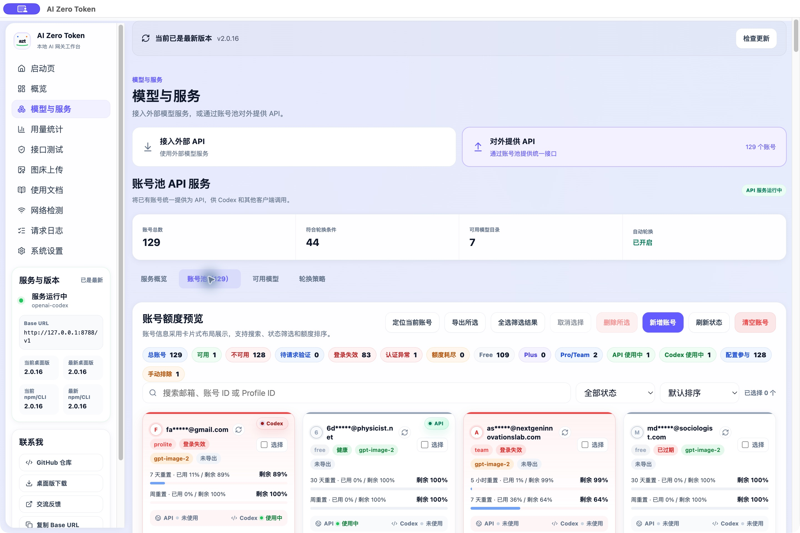

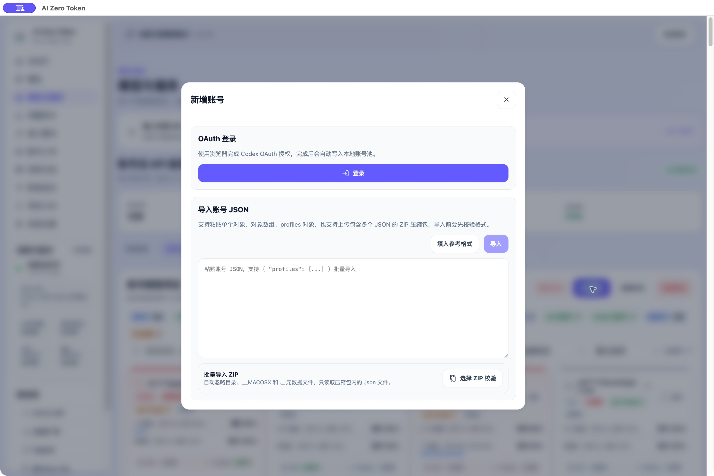

可以选择以下任一方式：

1. **OAuth 登录：** 点击“登录”，在浏览器完成 Codex OAuth 授权，保持客户端打开并等待账号写入账号池。如果 3 分钟内没有收到自动回调，把浏览器地址栏中的完整回调 URL 或 authorization code 粘贴回客户端后提交。
2. **导入 JSON：** 粘贴单个对象、对象数组或 `{ "profiles": [...] }`，然后点击“导入”。不确定格式时先点“填入参考格式”。
3. **导入 ZIP：** 点击“选择 ZIP 校验”。程序会忽略目录、`__MACOSX` 和 `._` 元数据文件，只读取压缩包内的 `.json`；校验通过后再导入。

> 导出的账号 JSON 含完整认证凭据，应当按密码文件管理，不要发送给不可信的人或服务。

**成功标志：** 新账号卡片出现在账号池，卡片能显示套餐、认证状态和额度信息。

### 1.2 获取 API 地址、密钥与调用示例

进入 `模型与服务 → 对外提供 API → 服务概览`。这里集中提供本机调用、局域网调用、调用示例和 API 访问密钥。

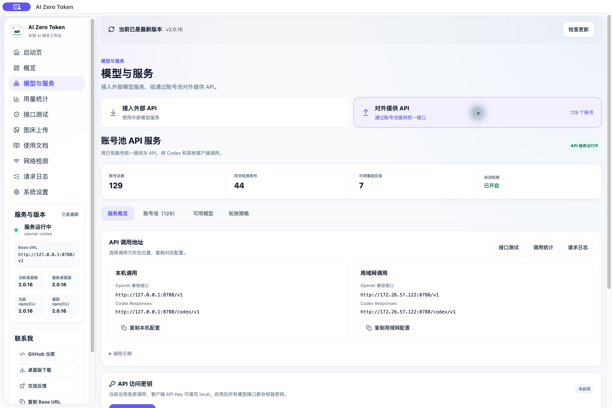

本机通常会显示两类地址：

```text
OpenAI 兼容接口：http://127.0.0.1:8787/v1
Codex Responses：http://127.0.0.1:8787/codex/v1
API Key：local
```

端口被占用时程序会使用其他端口，请直接复制自己客户端中的值。调用方运行在同一台电脑时用“本机调用”；运行在同一局域网的另一台设备时用“局域网调用”。

默认未启用密钥校验，第三方客户端强制要求 API Key 时可以填 `local`。需要限制访问时，在“API 访问密钥”区域生成或填写密钥并保存；启用后，模型接口都必须携带正确的 `Authorization: Bearer <密钥>`。不要把真实密钥写进公开文档或截图。

查看模型列表：

```bash
curl http://127.0.0.1:8787/v1/models \
  -H 'Authorization: Bearer local'
```

发起一次 Chat Completions 请求：

```bash
curl http://127.0.0.1:8787/v1/chat/completions \
  -H 'Content-Type: application/json' \
  -H 'Authorization: Bearer local' \
  -d '{
    "model": "替换为可用模型页中的模型 ID",
    "messages": [{"role": "user", "content": "请只回复 OK"}]
  }'
```

**成功标志：** HTTP 状态码为 `200`；模型列表返回 `data`，对话请求返回模型响应。

### 1.3 选择对外提供的模型

进入“可用模型”，确认当前账号池公开哪些模型。调用 API 时，`model` 必须使用这里实际显示的模型 ID。

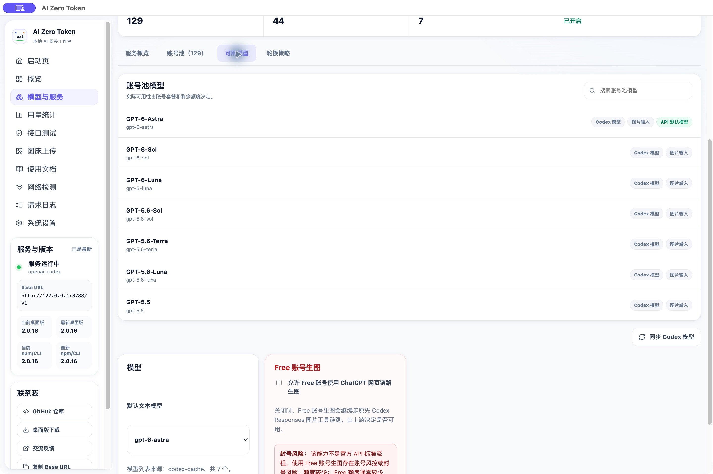

如果某个账号当前不可用、额度耗尽或被手动排除，它不会被自动轮换选中，即使模型仍显示在目录里。

### 1.4 接入 Codex

进入“接入 Codex”，选择要在 Codex 中使用的模型并保存。该操作会更新 Codex 配置；保存后应完全退出并重新打开 Codex，让它重新读取配置。

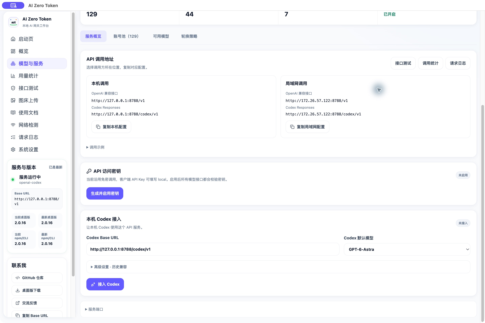

**成功标志：** 页面显示已接入，重启 Codex 后能看到所选模型并完成请求。

需要解除时，返回“模型与服务”，在页面顶部“当前接入 Codex”区域直接点击“解除接入”。解除只影响 Codex，账号池 API 服务会继续运行。

### 1.5 接入 OpenClaw 或其他客户端

任何支持 OpenAI 兼容接口的客户端，通常只需要三项：

| 配置项 | 填写内容 |
| --- | --- |
| Base URL | 客户端“服务概览”中显示的 OpenAI 兼容地址 |
| API Key | 未启用校验时填 `local`；启用后填实际访问密钥 |
| Model | “可用模型”页中显示的模型 ID |

OpenClaw 的现成模板可在左侧“使用文档”中打开“OpenClaw”标签后复制。其他客户端如果会自动拼接 `/v1`，注意不要重复写成 `/v1/v1`。

### 1.6 配置轮换策略

进入“轮换策略”可启用自动切换、调整刷新并发与请求间隔，并手动排除不参与轮换的账号。

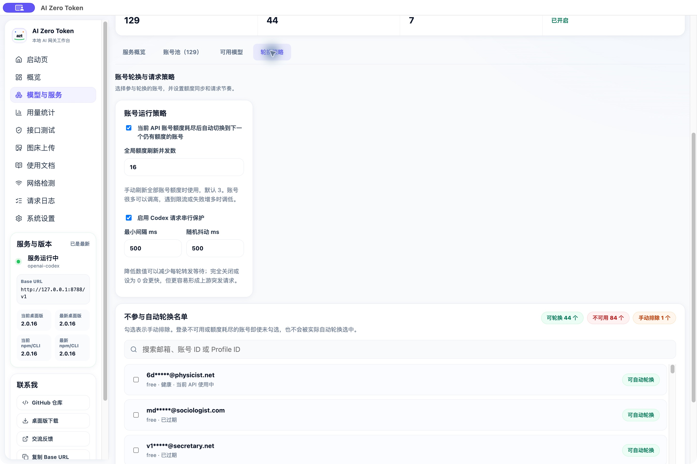

- 自动切换只会使用当前可登录、额度可用且未被手动排除的账号；
- 降低请求间隔可以减少等待，但更容易形成上游突发请求；
- 修改服务端口或关键网关设置后，按页面提示重启网关。

### 1.7 常见问题

- **返回 401：** 启用了访问密钥但客户端仍填 `local`，或请求没有 Bearer 头。
- **返回 model not found：** `model` 不是“可用模型”中当前存在的 ID。
- **局域网设备无法连接：** 检查监听地址、防火墙和“局域网调用”中的地址；不要把网关直接暴露到不可信网络。
- **Codex 保存后没变化：** 完全退出并重新打开 Codex。

## 2. 接入外部 API

### 功能用途与适用场景

“接入外部 API”用于保存第三方或自建服务，并把其中选定的模型接入本机 Codex。直接接管使用本身兼容 Codex 的模型；混合接管由 AZT 做兼容转换，让原本不能直接用于 Codex 的模型接入使用，也支持组合多个渠道的模型。

| 接管方式 | 适合什么情况 | 使用条件 |
| --- | --- | --- |
| **直接接管（默认）** | 模型本身兼容 Codex，无需做兼容转换 | 可选择显示模型状态，或独立使用本地模型列表 |
| **混合接管** | 模型原本不能直接用于 Codex，需要 AZT 做兼容转换；或希望组合多个渠道的模型 | 使用期间保持 AZT 运行，具体支持情况可查看模型的兼容性检测结果 |

例如，Claude、DeepSeek、Gemini 等模型在渠道未适配 Codex 时，可尝试通过混合接管进行兼容转换。模型名称仅作举例，能否接入以及采用哪种方式，取决于渠道提供的接口和兼容性检测结果；如果渠道已将 Claude 等模型适配为兼容 Codex，也可直接接管。

已有服务继续使用原来的直接接管方式；升级、打开页面或勾选模型都不会自动切换配置。两种方式的按钮都在具体渠道的模型选择页，确认后才生效。

> 外部 API 会直接消耗该服务 Token 对应的额度，不会经过 AI Zero Token 账号池轮换。

### 2.1 添加服务

进入 `模型与服务 → 接入外部 API`，点击“添加外部 API”。

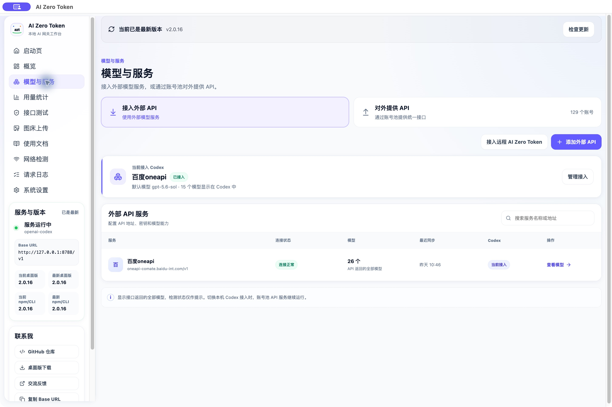

填写：

- **服务名称：** 便于自己识别，例如“公司 OneAPI”；
- **API Base URL：** 上游提供的 OpenAI 兼容地址，通常以 `/v1` 结尾；
- **API Token：** 上游分配的 Token，仅保存到本机；
- **模型获取方式：** 优先选择“自动获取模型列表”。如果服务不提供模型列表接口，再选择“手动填写模型 ID”。

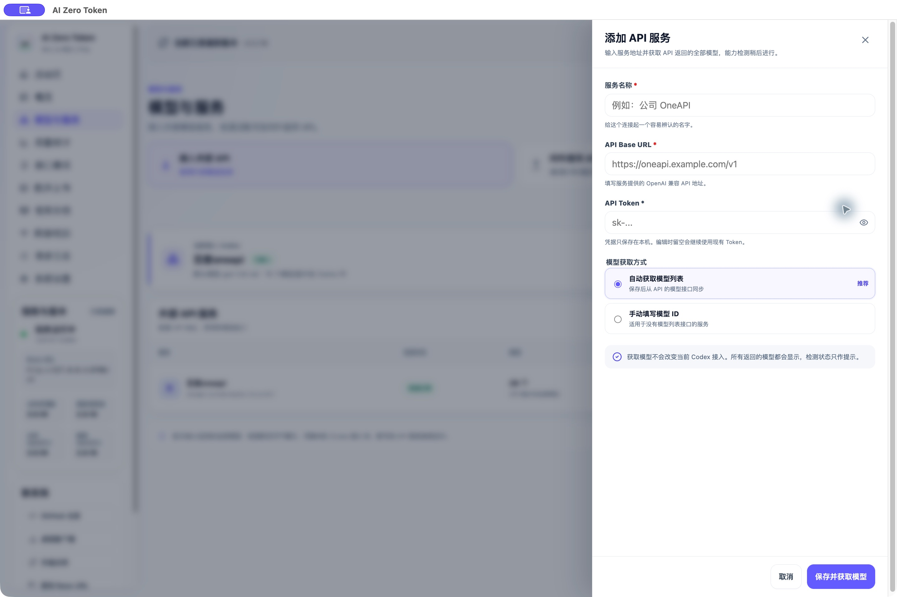

手动模式下逐行或按界面提示填写真实模型 ID：

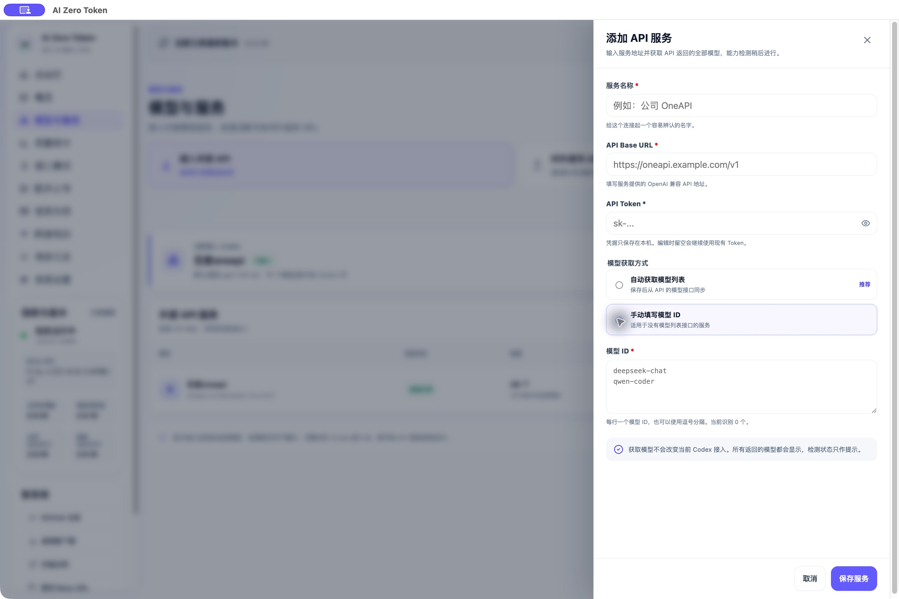

点击“保存并获取模型”只保存服务并同步模型，不会自动改变当前 Codex 接入。

### 2.2 同步并检查模型

打开服务详情，点击同步模型。渠道模型列表和接入选择页按厂商分组，可折叠分组、筛选厂商，或搜索模型与厂商名称。Claude、Sonnet、Opus 等同厂商名称会归到同一组，无法识别的模型放入“其他”。分类仅用于整理列表，不决定接口或接管能力。

接入页可全选某一厂商当前筛选出的模型；筛选隐藏的已选模型和默认模型会保留，组内继续按可用状态排序。需要判断接管能力时，对单个模型点“检测能力”，或点击“检测全部”；有搜索或筛选条件时，按钮会显示“检测筛选结果”和模型数量。检测按分组顺序分批完成全部结果，不再截断为前 20 个。

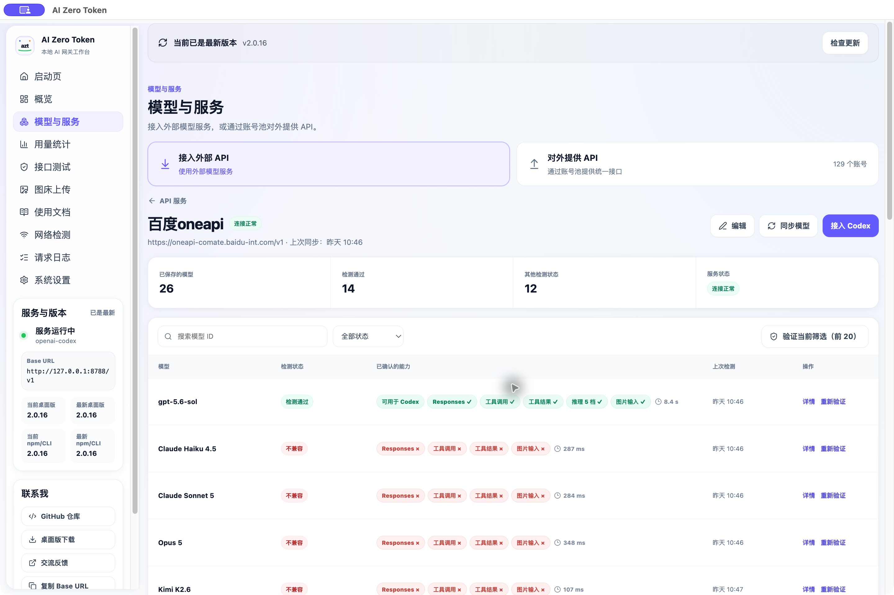

> 能力检测会向上游发送真实请求并消耗额度。检测状态只是提示：未检测、服务繁忙或本次检测失败的模型仍可勾选，最终兼容性以真实调用为准。

模型详情中可查看和修改上下文窗口。优先使用手动设置，其次使用渠道返回值；缺少这些信息时，Chat / Claude 兼容转换默认 128,000 tokens，直接接管 / Responses 沿用原有的 272,000 tokens。手动值会在同步模型后保留，也可以恢复自动值。接入页在两种方式下分别显示上下文及其来源；接口尚未识别时，混合方式会说明待识别及对应默认值。这个数值是写入 Codex 的配置，不代表上游承诺支持该长度。已有接入保留原值，重新接入后才应用新设置；数值不同时会同时显示当前生效值和重新接入后的值。

### 2.3 直接接管与混合接管

**直接接管：**

1. 在服务列表打开具体渠道，点击“接入 Codex”（已接入的渠道显示“管理接入”）。
2. 勾选要显示在 Codex 模型选择器中的模型。
3. 选择一个默认模型。
4. 点击顶部“直接接管”，在确认框选择“显示模型状态”或“独立使用 · 本地模型列表”。两种方式都由 Codex 直接访问该渠道的所选模型；需要更新模型选择或切换列表方式时仍点击此按钮。
5. 按确认框说明等待任务完成，完全退出 Codex，再点击“已关闭，继续”。仅打开或取消确认框不会改动配置；确认后的退出检查最多等待 15 秒，失败可处理后重试。

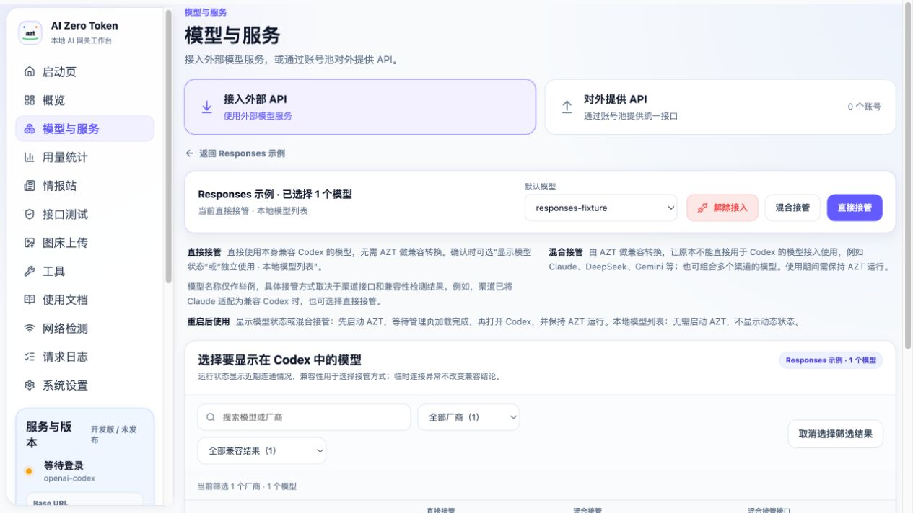

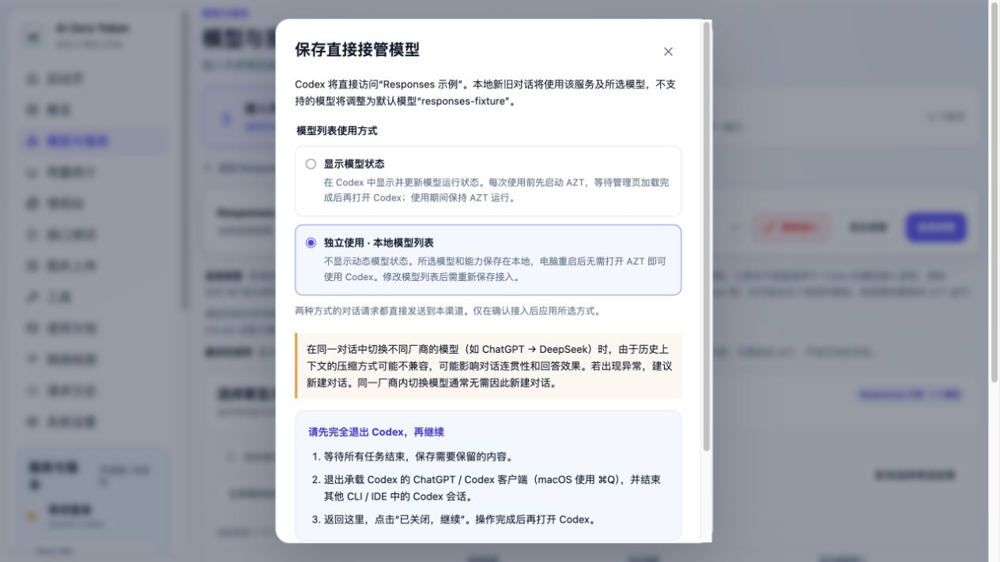

**成功标志：** 服务显示已接入，重启后的 Codex 能看到所选模型并完成请求。

**在模型菜单查看状态：**

选择“显示模型状态”的直接接管或混合接管后，Codex 从 AZT 的本机动态目录获取所选模型，名称带有 🟢 畅通、🟡 拥堵、🔴 不可用。直接接管选择“独立使用 · 本地模型列表”时，Codex 不显示动态状态，运行状态仍可在 AZT 查看。AZT 的接入页在每个模型名下直接显示“运行状态”，与两种方式的兼容性分开展示。已接入模型使用当前实际接口的检测结果，未接入模型使用已保存或已识别的接口，尚未识别时检查 Responses；检测时间与原因可悬停或展开“检测详情”查看。状态变化不改变模型 ID、已确认的推理档位或上下文设置。未检测、轻量请求未能确认、结果需要刷新时显示灰色。

在“模型运行状态”中选择自动检测周期：默认 30 分钟，可选 15／60 分钟或关闭，原来的周期与关闭设置会保留。自动检测开启时，AZT 启动后即检查所有已保存渠道中未检测或到期的模型，无需先接入或打开 Codex；之后按所选周期刷新，刚检测过的结果会复用，退出 AZT 后停止检测。“检测全部模型”手动检查全部已保存模型，最多同时检测 2 个，并显示总进度。自动巡检每批最多 20 个，剩余到期模型在每分钟的后续轮询中继续检查，优先检查最久未检测的模型。每个模型仅按当前接入、已保存或已识别的接口发送一次短生成请求，将输出上限设为 32 token，不自动重试，不重新检测兼容性、工具、图片或推理档位。上游可能计费，实际用量以服务商记录为准。

“畅通”表示最近的测试请求得到了完整文本结果，不保证后续请求或全部能力可用；限流、服务繁忙、超时显示“拥堵”，鉴权失败、模型不支持、网络错误等显示“不可用”。这些检测结果都会更新检测时间。混合接管按所选接口分别检测，Responses 的检测结果不会直接套用到 Chat 或 Claude 接口。超过两个检测周期（至少 60 分钟）没有新结果时显示“待刷新”，并非模型不可用；悬停可查看上次检测时间、待刷新原因和上次结果。

**直接接管可选择两种模型列表方式：** 选好模型后点击“直接接管”，在确认框选择：

- **显示模型状态**：保留 Codex 模型名称中的动态运行状态。每次使用前先启动 AZT，等待管理页加载完成，再打开 Codex，并在使用期间保持 AZT 运行。
- **独立使用 · 本地模型列表**：所选模型及其推理档位、上下文和图片能力保存在本地，不显示动态运行状态。完成接入后，关闭 AZT 或重启电脑均可直接打开 Codex；请求仍直连上游。修改显示模型或能力设置后，需在 AZT 重新保存接入并按流程打开 Codex。

首次接入默认选择“显示模型状态”，每个渠道会记住上次确认的选择；旧接入根据当前配置识别。打开、选择或取消确认框均不会修改配置，只有确认接入后才生效。两种方式可以通过“管理接入”重新选择，切换时需按提示完全退出 Codex。它们是明确选择的两种模式，不会在运行中自动回退。AZT 中的模型状态检测设置不受这个选择影响。

**动态目录的刷新与启动：** Codex 有自己的缓存，显示可能延迟数分钟，重新打开下拉菜单不保证立刻更新。读取目录不会发起检测或消耗模型 token。目录使用单独保存的本机端口，修改 AZT 管理页端口不会再改变目录地址。旧版动态接入若提示有更改待应用，请在更新 AZT 后重新保存一次接入；升级或打开页面不会自动改写接入配置。混合接管仍需先启动 AZT 并保持运行，退出 AZT 会使目录不可访问、对话请求无法转发。

**电脑重启后模型列表为空：** 若使用“显示模型状态”或混合接管，先打开 AZT，等待管理页加载完成；若已先打开 Codex，请等待当前任务结束后完全退出并重新打开。若不想随 Codex 启动 AZT，可在直接接管确认框选择“独立使用 · 本地模型列表”并保存一次。若仍为空或提示端口占用，处理错误后重新保存接入。

**混合接管：**

1. 在具体渠道内进入“接入 Codex”或“管理接入”，勾选模型并选择默认模型。两个接管按钮共用这组选择，无需跳转或重新勾选。Claude 原生接口可使用手动模型 ID，无需先通过原有 Responses 能力检测。
2. 接口默认“自动识别”，通常无需调整。AZT 优先复用已确认的接口；未知模型会依次验证 Responses、OpenAI Chat、Claude Messages，不按模型名称猜测。特殊服务可在对应模型行点击“调整”手动指定，之前保存的手动选择会保留。Base URL 填写接口前缀，例如以 `/v1` 结尾，不要填入完整的 `/messages` 或 `/chat/completions` 路径。
3. 点击顶部“混合接管”，阅读提示并按说明退出 Codex 后确认。需要识别时，每个未知模型最多发送 3 次短请求，每次输出上限 32 token，服务商可能计费；打开页面、勾选模型或取消弹窗不会触发识别。全部确认后，AZT 将本渠道所选模型接入中转，保留其他渠道已启用的混合模型，并使用本页选择的默认模型。识别失败会显示具体模型及原因，当前 Codex 接入配置保持原样，可重试或调整接口。
4. 要加入另一渠道，再进入该渠道选模型并点击“混合接管”。重新打开 Codex 后，模型名称会包含服务名称。修改时进入对应渠道的“管理接入”，每次接管仍会弹出提示。改点“直接接管”会停止当前混合接管，改为只使用该渠道所选模型。

**一次检测两种接管方式：** 在模型行或模型“详情”中点击“检测能力”，AZT 会先检测 Responses。直接接管和 Responses 原样转发共用同一次能力检测的状态和时间，不重复发送对话、工具测试；只有需要 Chat / Claude 接口转换时，才追加转换后的对话、工具调用和结果回传验证。模型列表固定显示“直接接管”和“混合接管”两行，不隐藏另一种方式，也不区分优先级。接口识别成功或连通测试成功都不等于完整能力检测通过。

接入页显示两种方式的兼容性与上下文，识别出的接口与手动调整入口保留在模型行。兼容性用于选择接管方式：通过必要的对话、工具调用和结果回传验证后显示“兼容”；明确不支持接口或必要能力时显示“不兼容”；尚未检测显示“未检测”；已尝试但未获得足够结论时显示“检测未完成”。展开“检测详情”可查看时间、工具检查项、具体原因和独立的连通状态。

网络异常、超时、限流、服务繁忙或凭据问题不属于兼容性结论：已有结论时保留“兼容”或“不兼容”，另行提示本次检测未完成；没有历史结论时才显示“检测未完成”。Responses 两种方式共用同一兼容结论，临时失败不会自动改换接口。切换到尚未验证的转换接口时显示未检测，不沿用其他接口的结果。列表与接入页按兼容的接管方式统计和筛选；Codex 动态目录中的彩色状态继续反映近期连通性。

渠道页的“检测全部”或“检测筛选结果”使用同一流程，每批处理 4 个，直到全部完成，无需逐个点击。检测在后台继续，Responses 共用结果保存后即完成该模型，转换接口在额外验证完成后更新进度。确认不兼容时，只探测其余转换接口，不重复请求 Responses；后续接入复用已识别接口。重新检测只更新检测记录，不修改已保存的模型选择、默认模型、手动接口或上下文窗口。

检测会发送少量请求，服务商可能计费。使用模拟工具，不执行命令或读取用户文件，不更改当前 Codex 接入。Responses 原样转发不追加测试请求；需要接口转换时，识别最多 2 次短请求（各 32 token），转换验证最多 3 次请求（各 512 token）。兼容结果不保证全部功能或后续请求可用；更换渠道地址或密钥会清除旧结果。仅识别出转换接口、尚未完成必要能力验证时显示“检测未完成”，不会误报兼容。

服务列表保留当前接入状态，接管方式的操作入口集中在渠道内。开始新的混合接管时，不会自动重新启用此前已停用的其他渠道。

识别成功的结果随模型保存，后续接入优先复用；修改服务地址或密钥后会重新识别。接口已识别不代表当前服务畅通或所有工具能力均已验证。限流、超时和网络故障会提示处理，不会据此猜测另一种接口。

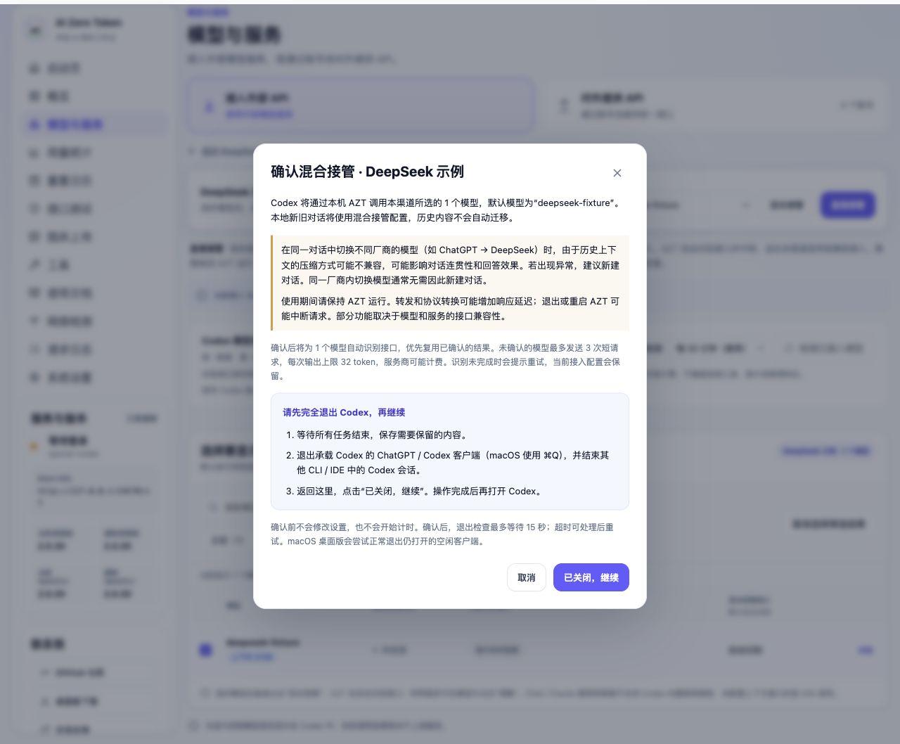

两种方式每次接管前都会提醒：在同一对话中切换不同厂商（如 ChatGPT → DeepSeek），历史上下文的压缩方式可能不兼容，影响连贯性和回答效果；出现异常时建议新建对话。同一厂商内切换模型通常无需因此新建对话。这是使用前告知，不会按厂商品牌强制新建对话，也不会自动迁移历史。已经加密且无法读取的历史会返回明确错误，不会悄悄删除后继续发送。

混合模式需保持 AZT 运行。转发和协议转换可能增加响应延迟，退出或重启 AZT 可能中断请求。Chat / Claude 兼容转换支持文字、图片输入（取决于模型）、流式输出及函数/自定义本地工具；暂不提供 Codex 内置联网搜索等服务端工具，Claude 结构化输出与扩展思考也未做转换。需要这些能力时使用支持它们的 Responses 服务。现有“检测能力”主要验证直接接管，不代表转换后所有功能都兼容。

兼容转换模型没有手动或渠道窗口资料时按 128K 配置；已有接入（包括之前的 32K 默认值）不会自动改写，重新接入后才应用新的默认值。请在模型详情按服务商说明填写实际窗口后重新保存接管。混合模式支持在同一服务和接口内继续使用其生成的长对话摘要，不会自动把别家服务的加密压缩内容转换过来。

Chat 接口返回的 `reasoning_content` 会作为不透明状态保留，并在同一服务和接口的后续工具调用中回传；不会转成正文或迁移给别家服务。此处理符合 [DeepSeek 思考模式接口说明](https://api-docs.deepseek.com/guides/thinking_mode/)中的回传要求，具体模型兼容性仍以上游实际调用为准。

混合请求使用对应外部服务的密钥和额度，不参加账号池轮换，也不计入账号池用量统计。修改已选服务的地址或密钥后，需要重新保存混合接管；当前配置不会悄悄切到新地址。AZT 重启后使用原端口恢复本地转发；端口被占用时会提示处理，不会自动更换端口导致 Codex 配置失效。

### 2.4 解除接入

进入 `模型与服务 → 接入外部 API`，在页面顶部“当前接入 Codex”区域直接点击“解除接入”。也可以进入“管理接入”，使用顶部的同名按钮。按确认框说明先等待回复完成并完全退出相关 Codex 进程；macOS 桌面版会尝试正常退出仍打开的空闲客户端，不会强制结束正在运行的任务。完成后再打开 Codex。

混合接管支持在渠道内点击“解除本渠道接入”，其他渠道会继续接入；移除最后一个渠道时恢复原生 Codex。需要一次解除所有混合渠道时，在列表页的当前接入状态中点击“解除全部接入”。

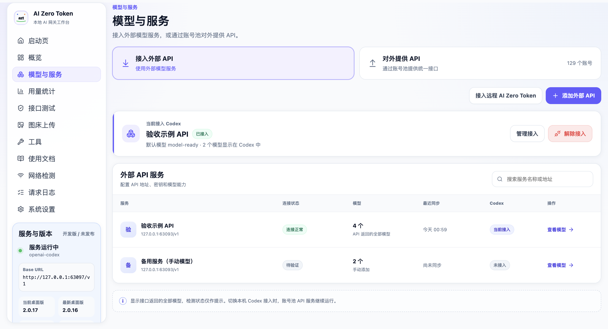

解除接入只取消这个服务对 Codex 的接管，外部 API 服务、Token、模型检测记录和已选模型都会保留，之后可以直接再次接入。它不会停止账号池对外提供 API，也不会删除外部服务。

从 2.0.20 起，解除接入不需要先登录账号或同步模型目录。原有对话恢复接入前的模型与推理设置；原先未指定模型、或接入第三方期间新建的对话，由 Codex 使用原生默认设置。遇到旧版“无法确定原生默认模型”提示时，升级后重新解除即可，无需删除对话或手工修改配置。实际使用原生服务时，仍需满足 Codex 自身的登录要求。

第三方共用固定的 `azt_active` provider，原生模式使用 `openai`。接入时同步当前 Codex 数据目录中已有会话的 provider 和模型，所以新旧本地对话都使用当前服务。解除时统一回到原生 Codex 服务，不恢复此前的其他第三方。AZT 不手工改写会话 JSONL，也不替换原生登录；Codex 后续会自行记录新的会话设置。

普通数据库查看器打开文件不会直接阻止切换；真实写锁冲突会停止操作并显示排查提示。请释放未提交的写事务后重试。正在运行的 Codex 回复仍会阻止切换；错误提示会保留，可手动关闭。

直接接管的请求从 Codex 发往对应服务，活动 Key 同时存在 AZT 的服务记录和 Codex 配置中。混合接管在 Codex 配置中使用独立的本机网关密钥，外部服务密钥由 AZT 按所选模型使用，本地入口仅监听回环地址。解除后移除固定活动配置中的 Key，保留 AZT 服务资料和兼容 provider 定义，避免旧历史元数据中的名称变成缺失引用。混合模型选择也会保留；删除正在用于混合接管的服务前，请先移除对应选择或解除混合接管。

切换前会备份配置与 SQLite 数据库。失败时尝试恢复；若中断后又产生新消息或配置修改，会停止自动回滚并保留备份。再次接管或解除时先处理未完成的切换。备份位于 `~/.ai-zero-token/.state/codex-switch-backups/`，其中可能包含凭证和会话数据库，请勿公开上传。

**成功标志：** 页面不再显示该服务为“当前接入”，服务和模型记录仍保留在外部 API 列表中。

必须知道的规则：

- 同一时间只能接入一个模型服务；接入另一个服务会替换当前 Codex 的模型服务配置。
- 会话原模型在新服务中可用时保留，否则改用新服务的默认模型。解除时优先恢复原生模型偏好。
- 启用中的 Codex profile 或项目配置如果覆盖了连接/模型，会阻止统一切换；需先处理这些覆盖。
- 从统一第三方接管切到旧账号池入口前，先解除第三方接管，防止只改默认配置而遗漏已有会话。
- 切换 Codex 到外部服务不会停止账号池对外提供 API，其他客户端仍可调用本地账号池。
- 编辑已接入服务的地址、Token 或模型后，需要重新保存 Codex 接入配置。
- API Token 属于敏感凭据，不要出现在截图、日志、Issue 或聊天记录中。

## 3. 图床上传

### 功能用途与适用场景

“图床上传”把本地图片批量上传到当前 GitHub 账号的公开仓库，并返回可直接使用的公网原图链接。适合为 Markdown、Issue、说明文档或图片接口准备可访问 URL；不适合上传隐私图片、密钥截图或不应公开的资料。

### 3.1 准备 GitHub 仓库和 Token

首次使用前需要在 GitHub 完成两项准备：

1. 创建名为 `azt-img-bed` 的**公开仓库**。当前版本的仓库名固定，图片会写入 `images/` 目录。
2. 创建 GitHub Personal Access Token，并在 Repository access 中包含 `azt-img-bed`。具体权限与创建步骤可展开页面底部“GitHub token 创建说明”查看。

进入左侧“图床上传”，在 Token 区填写 Token 并保存。程序会验证当前 GitHub 用户、仓库和默认分支。Token 只应保存在自己的电脑，不要粘贴到文档或发给他人。

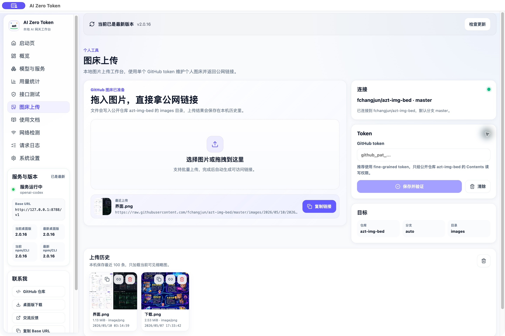

### 3.2 上传并复制链接

连接成功后，把一张或多张图片拖入上传区，或点击“选择图片”。上传完成后，页面会显示“复制链接”，并把记录加入本机上传历史。

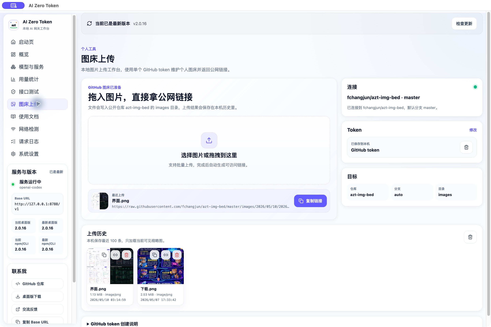

**成功标志：** 右侧连接状态为绿色，显示 `GitHub 用户名/azt-img-bed · 默认分支`；上传结果出现缩略图和 `raw.githubusercontent.com` 链接。

### 3.3 管理历史与远端文件

上传历史最多在本机保存最近 100 条。每个历史卡片可以复制链接、打开 GitHub 页面或删除：

- 删除**单条上传记录**会同时删除 GitHub 仓库中的对应远端文件；
- “清空历史”只清除本机历史，不会删除 GitHub 上的图片；
- 清除 Token 会移除本机保存的图床凭据，不会删除仓库或已经上传的图片。

### 3.4 常见问题

- **验证失败：** 确认仓库名严格为 `azt-img-bed`、仓库是公开的、Token 能访问该仓库。
- **链接暂时打不开：** GitHub 原图链接可能有短暂缓存延迟，稍后再试。
- **图片不应公开：** 不要上传。该功能使用公开仓库，获得链接的人可能访问图片。

## 4. 接口测试

### 功能用途与适用场景

“接口测试”是在客户端内验证当前账号池 API 的工作台，适合首次接入、排查请求体、确认模型能力，或在配置第三方客户端之前先做最小验证。

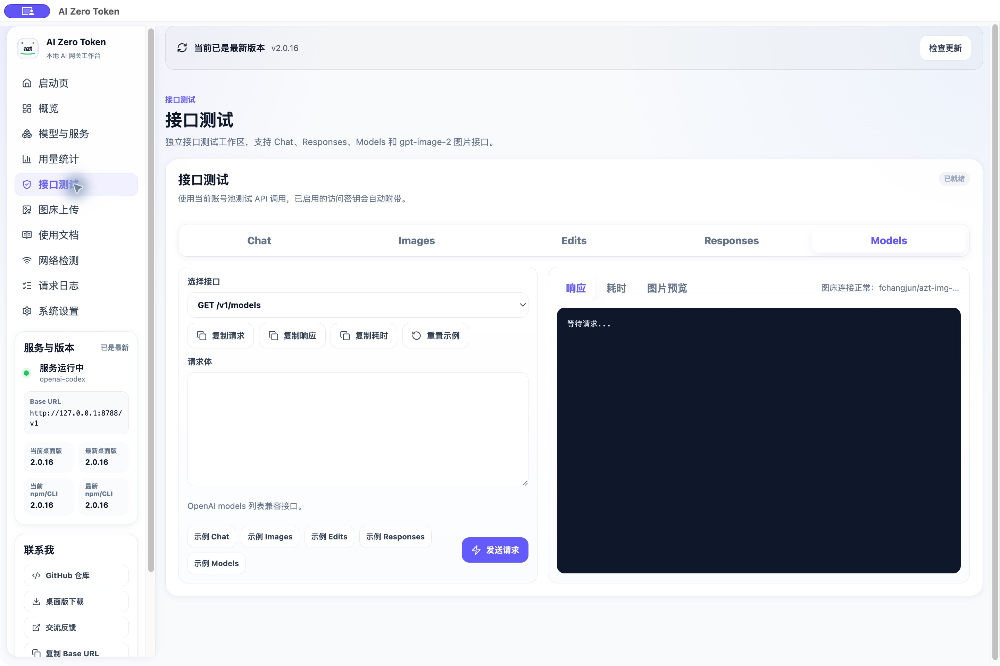

### 操作方法

1. 在顶部选择 `Chat`、`Images`、`Edits`、`Responses` 或 `Models`。
2. 在“选择接口”中确认具体路径；页面会自动生成示例请求体。
3. 修改模型 ID、提示词或图片参数。图片编辑可选择 Base64，也可以在图床已配置时上传并写入公网链接。
4. 点击“发送请求”，在右侧查看响应、耗时和图片预览。

**成功标志：** 右侧“响应”出现成功 JSON；图片请求还会在“图片预览”中显示结果。

> 除读取 Models 外，测试通常会向上游发送真实请求并消耗账号或外部服务额度。图片生成和编辑尤其可能产生费用，不要为了试界面反复发送。

## 5. 用量统计

### 功能用途与适用场景

“用量统计”汇总真实网关请求，适合观察账号和模型使用量、估算费用、失败率、响应耗时以及图片调用情况。

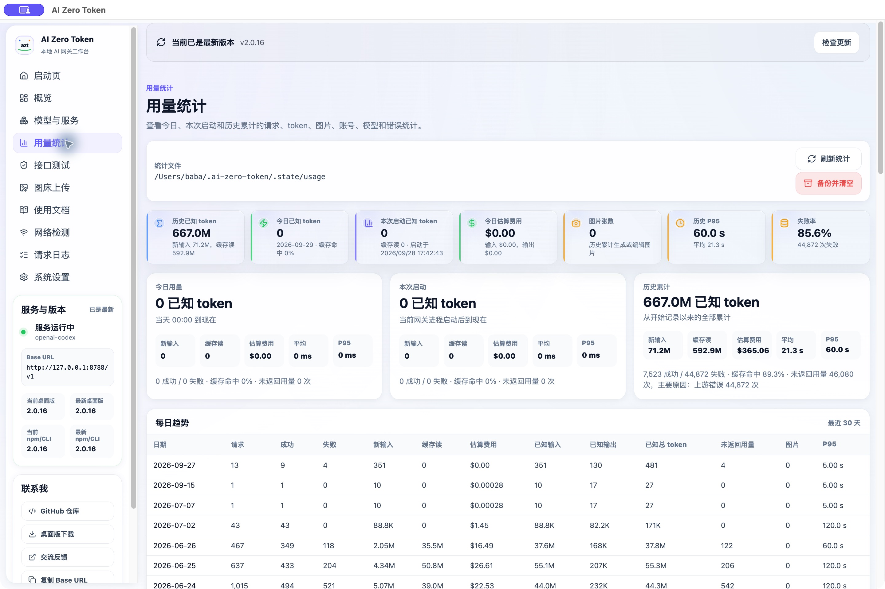

页面显示今日、本次启动和历史累计的已知 token、新输入、缓存读、估算费用、图片数、成功/失败、平均耗时和 P95，并按日期、账号、模型、接口、用量捕获状态、错误、生图链路和来源汇总。

点击“刷新统计”读取最新结果。“备份并清空”会先备份当前统计目录，再从 0 重新统计。

**成功标志：** 新请求完成后刷新页面，相应时间段和维度的请求数发生变化。

> 统计不保存提示词、消息内容、Token 或 base64 图片。费用是根据已知用量计算的估算值，不等同于上游账单；部分上游不返回 usage 时会计入“未返回用量”。

## 6. 请求日志

### 功能用途与适用场景

“请求日志”用于按时间、方法、来源和状态查看网关最近收到的 API 请求，适合排查 401、404、模型不兼容、上游错误和响应过慢。

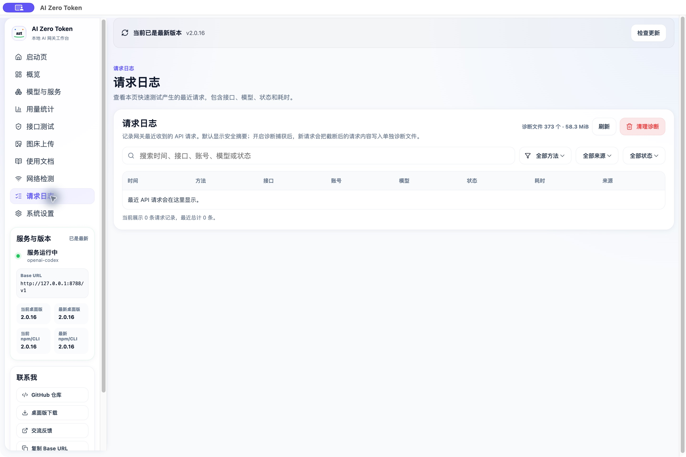

使用搜索框按时间、接口、账号、模型或状态搜索，也可以用“全部方法”“全部来源”“全部状态”筛选。普通日志记录状态码、耗时、账号、模型、接口和安全摘要，不保存完整提示词。

系统设置中可以开启“将 Codex 请求内容写入独立诊断文件”；之后的新请求会保存截断后的上下文摘要，必要时还可开启完整返回 SSE 协议。回到请求日志后可以查看引用或清理诊断文件。

**成功标志：** 发出请求并刷新后，表格中出现对应时间、接口、状态和耗时。

> 诊断文件可能包含请求上下文；只在排障期间开启，完成后及时关闭并清理。清理诊断不会删除普通请求日志和用量统计。

## 7. 网络检测

### 功能用途与适用场景

“网络检测”用于判断当前机器访问海外上游的基础网络环境，适合排查 OAuth 页面打不开、接口超时、代理未生效或 WebRTC/DNS 泄漏。

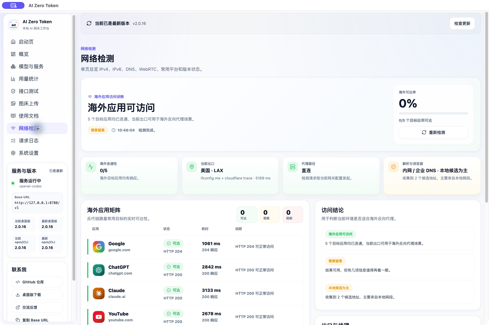

打开页面会自动检测，也可以点击“重新检测”。结果包括公网 IPv4/IPv6、出口位置、系统 DNS、当前代理、WebRTC 候选，以及 ChatGPT、Claude、Google、YouTube 和 X 的连通性。

**成功标志：** 检测结束后各卡片从“待检测”变为明确结果，并给出海外应用可达率和访问结论。

> 结果只代表当前网络环境，不代表账号拥有调用权限。平台“可达”也不等于所有 API 或 OAuth 流程都一定成功。

## 8. 客户端内置使用文档

### 功能用途与适用场景

“使用文档”根据当前运行端口动态生成接入参数，适合复制 Base URL、API Key、OpenClaw 模板、Skill.md 和示例代码，不必手工替换截图中的地址。

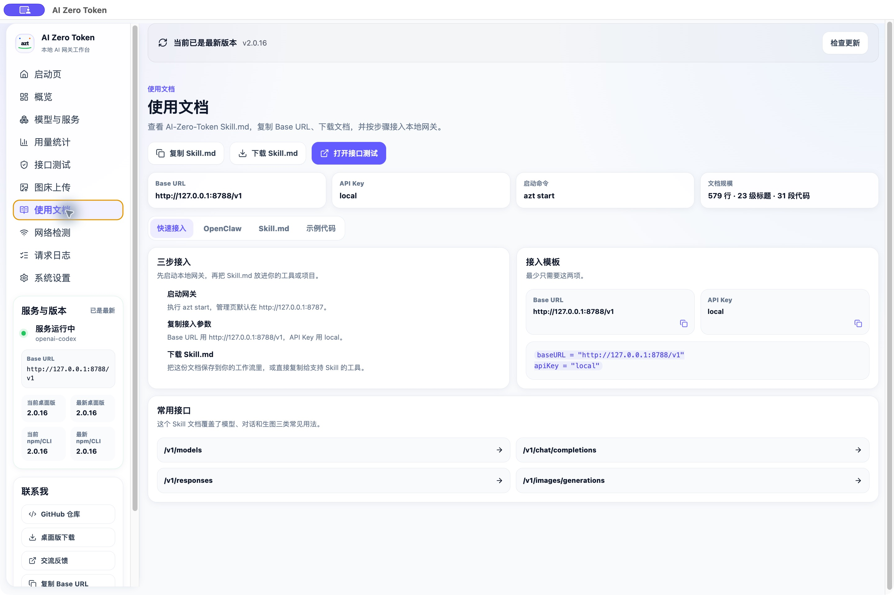

打开 `快速接入`、`OpenClaw`、`Skill.md` 或 `示例代码` 标签，按需复制内容；也可以下载 Skill.md，放入支持 Skill 的工具或项目。

**成功标志：** 复制的 Base URL 与客户端左侧当前 Base URL 一致，调用后返回成功响应。

## 9. 系统设置

### 功能用途与适用场景

“系统设置”集中管理影响整个客户端的网络代理、诊断记录和显示偏好。适合代理环境、流式协议排障，以及需要隐藏邮箱的场景。

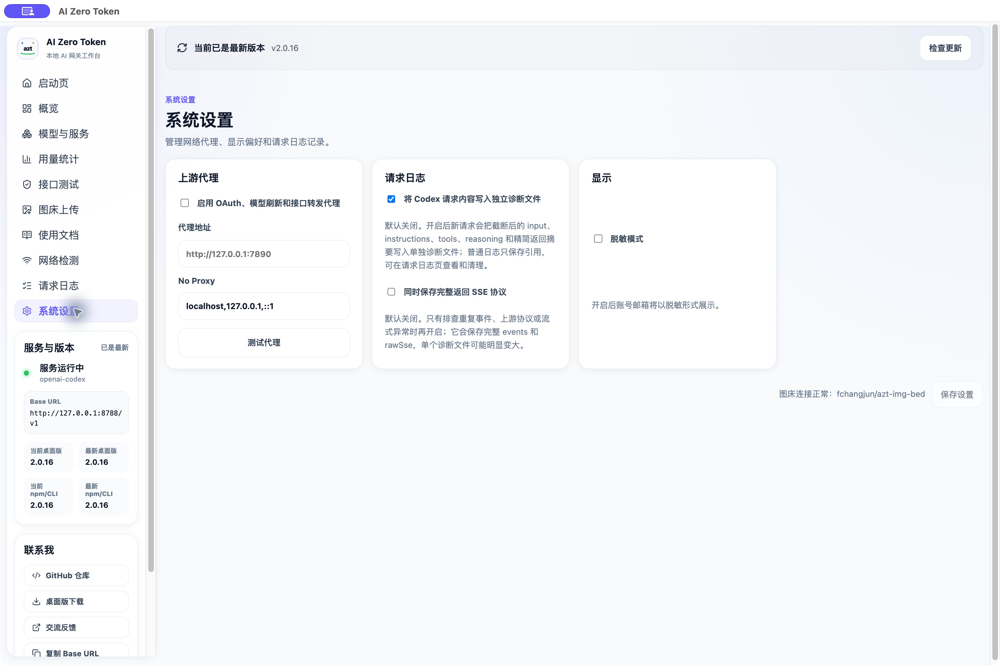

- **上游代理：** 为 OAuth、模型刷新和接口转发启用代理；填写地址与 No Proxy 后先点“测试代理”。
- **请求日志：** 开启 Codex 请求内容诊断；只有排查重复事件、协议或流式异常时再同时保存完整 SSE。
- **显示：** 开启“脱敏模式”后，账号邮箱会以脱敏形式显示。

修改后点击“保存设置”。

**成功标志：** 页面提示保存成功；代理测试返回可用，或界面中的邮箱按设置脱敏。

> 代理地址错误可能导致 OAuth、模型刷新和接口转发失败。完整诊断内容可能包含请求上下文，请仅在排障期间开启并妥善保管。

## 10. Response Reviewer

进入左侧“工具”，可以启用本地 Response Reviewer，对具体回复添加批注并汇总修改意见。服务默认关闭，不参与模型请求转发。

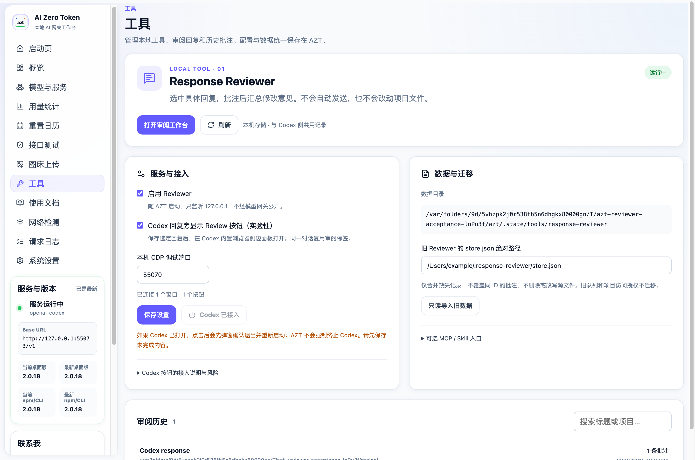

1. 勾选“启用 Reviewer”，点击“保存设置”。
2. 点击“打开审阅工作台”，或从“审阅历史”打开已有记录。
3. 如需在 Codex 回复旁显示 Review 按钮，另行勾选实验性开关并点击“保存并启动 Codex 接入”。如果 Codex 正在运行，会先请求你确认正常退出并重启；请提前保存未完成内容。
4. 在选定回复上添加文字批注或整体意见，使用“复制指令”汇总后自行发送。“放入对话框”会核对当前对话和空白草稿，确认匹配才预填；已有草稿、目标不明确或对话不一致时不会写入，仍需自己确认发送。旧版 Reviewer 后端需要重启后才能启用此能力。

Reviewer 不自动发送消息，也不自动改写项目文件。读取关联文件前必须确认项目目录。实验性 Review 按钮会先保存回复，再尝试在 Codex 内置浏览器侧边面板打开；同一对话复用审阅标签。它依赖当前 Codex 的页面结构、内部事件及本机调试连接，不是官方稳定接口；若不兼容，可手动选择内嵌回退入口或回到 AZT 工作台查看相同记录。不要公开或转发调试端口、含访问令牌的工作台链接。

关闭服务不会删除审阅记录。在“数据与迁移”填写旧 `store.json` 的绝对路径并点击“只读导入旧数据”，只合并缺失记录，不修改旧文件、不覆盖已有批注，也不继承旧的文件访问授权。详细步骤见 [Reviewer 使用与迁移说明](REVIEWER_MIGRATION.md)。

## 11. 重置日历

进入左侧“重置日历”，按北京时间查看 Codex 公开重置历史，切换月份或按普通重置、储备重置筛选。点击日期查看消息详情；有匹配的中文参考译文时，与英文原文一起展示，可复制来源链接核对。

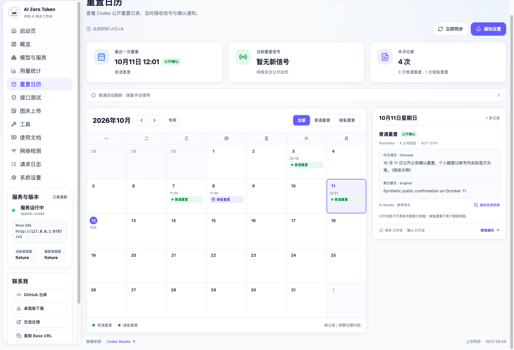

“当前重置信号”和计划公告不是已执行结果，只有公开确认后才标记确认。“通知设置”可分别控制信号和确认通知，并在桌面版发送测试通知。首次同步只导入历史、不补发通知；应用运行时后台同步，断网保留缓存并退避重试。系统通知需要操作系统允许，点击通知可返回日历。

**注意：** 这是公开消息日历，不是个人账号额度监测。计划时间到达不会自动推断重置完成，储备重置也不等于额度已到账；实际额度以账号内显示为准。详见 [重置日历说明](RESET_CALENDAR.zh-CN.md)。

## 桌面端和网页管理页有什么差异

桌面客户端和 CLI 打开的网页管理页使用同一套管理界面，所以账号池、外部 API、模型、轮换、图床、日志、统计和接口测试的字段及操作流程一致。桌面端界面可直接参照本指南中的截图。

桌面端额外提供原生应用窗口和网关生命周期管理、macOS 菜单栏账号面板、桌面应用更新，以及部分流程中的直接重启网关或 Codex。网页管理页没有这些原生能力，但核心功能可以按本文相同路径操作。

## npm / CLI 使用方式

需要 Node.js 22 或更高版本：

```bash
npm install -g ai-zero-token
azt start
```

`azt start` 启动网关并尝试打开管理页；`azt serve` 只启动服务。也可以指定监听地址和端口：

```bash
azt start --host 127.0.0.1 --port 8787
```

桌面端和 CLI 共享同一套本地状态。只允许本机使用时建议监听 `127.0.0.1`。

## 数据、安全与常见问题

### 本地数据保存在哪里

默认状态目录：

```text
~/.ai-zero-token/.state
```

可通过环境变量改变应用目录：

```bash
AI_ZERO_TOKEN_HOME=/path/to/home azt start
```

### 为什么界面中的账号、端口或模型与指南不同

账号状态、端口、服务名、模型和统计数据会随本机配置及运行情况变化。请以客户端当前显示的 Base URL、密钥和模型 ID 为准。

### 端口被占用怎么办

桌面端会显示实际端口。CLI 可以明确指定其他端口：

```bash
azt start --port 8790
```

然后把所有客户端 Base URL 一并改为新端口。
